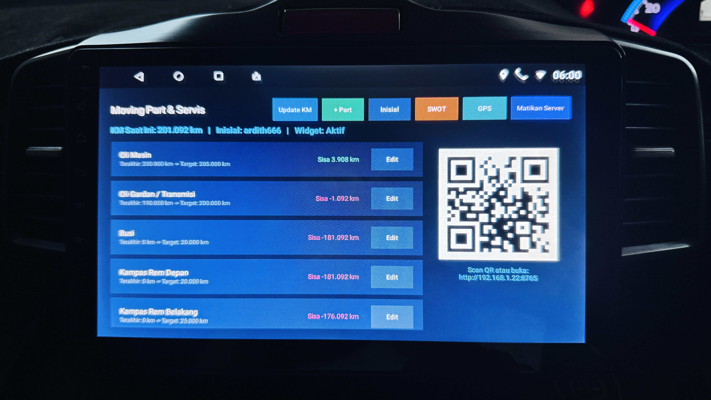
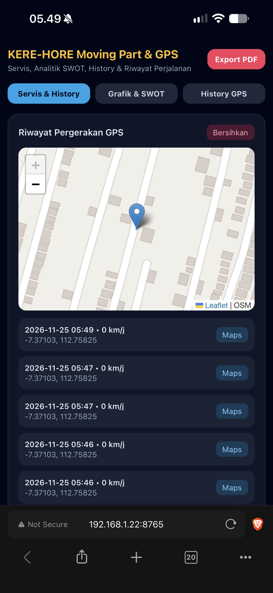
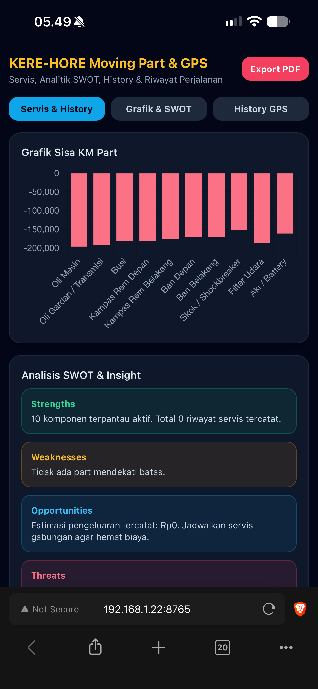
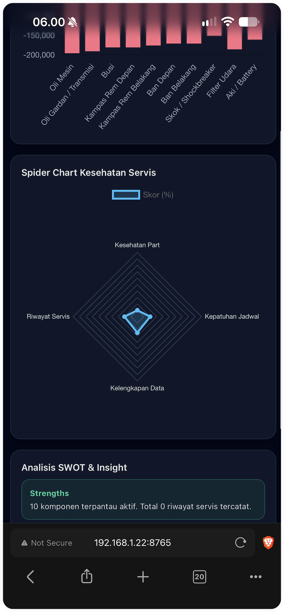
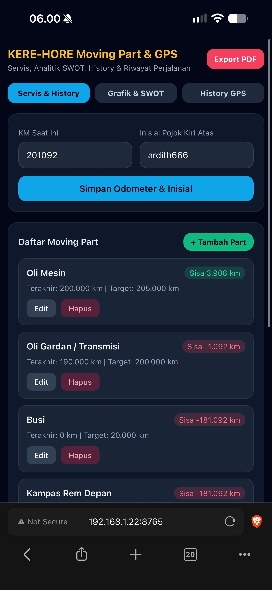

# KERE-HORE

**KERE-HORE** adalah launcher ringan untuk Head Unit (HU) Android spesifikasi terbatas (*kere-hore*), dibangun tanpa animasi berat dan tanpa library eksternal.



---

## Fitur Utama

1. **Launcher Ringan & Tema Aksen**
   - Tampilan gelap hemat resource dengan pilihan warna aksen (**Orange/Amber, Biru, Hijau, Merah, Ungu**) di **Pengaturan -> Tema**.
   - Indikator **RAM Asli** (membaca dari `/dev` tmpfs untuk menghindari spoofing firmware), **CPU**, **Suhu**, **Kecepatan GPS**, **Waktu Sholat & Tanggal Hijriah**.
   - **Tentang Head Unit (Spek Asli):** Menampilkan hardware, CPU, RAM asli, storage asli, dan suhu CPU.

2. **Moving Part Tracker & Webserver Lokal (`:8765`)**
   - Mencatat penggantian part (*Oli Mesin, Oli Gardan, Busi, Kampas Rem, Ban, Skok, Filter Udara, Aki, dll.*) + field opsional (*Merk, Tipe, Harga*).
   - **Webserver On-Demand + QR Code:** Buka dari HP dengan scan QR atau akses `http://<IP-HU>:8765`.
   - Dilengkapi **Chart.js** (Bar & Spider/Radar Chart), **Analisis SWOT & Insight**, **Riwayat Servis**, dan **Export PDF**.
   - Widget ringkasan jadwal servis terdekat di halaman utama (di bawah Jam/GPS) dan kustomisasi inisial pojok kiri atas (default `ardith666`).

3. **GPS Trip Logger & Map Playback**
   - Mencatat pergerakan GPS di latar belakang secara ringan dengan **deduplikasi titik parkir** (`< 25m` & `0 km/j`) dan pengelompokan perjalanan (`tripId`).
   - Di Webserver: peta rute **Leaflet JS**, **MarkerCluster toggle**, **Fullscreen**, **Animasi Playback (1x/2x/5x)**, **Export GPX**, info total ukuran data, serta konfirmasi hapus 10 detik.

4. **Al-Qur'an & Dzikir Offline**
   - Pemutar Al-Qur'an dengan fitur **Unduh Semua Audio (Offline)** pilihan kualitas **LQ (64 kbps, ~450 MB)** atau **HQ (128 kbps, ~950 MB)**.

---

## Instalasi, Debloat & Panduan AI Agent

Lihat panduan lengkap step-by-step di [docs/AI_AGENT_SETUP.md](docs/AI_AGENT_SETUP.md) untuk mengaktifkan Developer Mode, koneksi ADB (`5555`/`8555`), debloat aman, instalasi APK, dan optimasi HU.

### Build dari Source
```bash
./build.sh
adb connect <IP_HU>:5555
adb -s <IP_HU>:5555 install -r build/kere-hore.apk
```

---

## Tangkapan Layar Lainnya

| | |
|---|---|
|  |  |
|  |  |

---

## Lisensi
Proyek ini menggunakan **MIT License** (lihat [LICENSE](LICENSE)) dan merupakan pengembangan mandiri yang awalnya terinspirasi/berbasis dari proyek open-source **KlikDash** (`github.com/ashafizullah/klikdash`).
